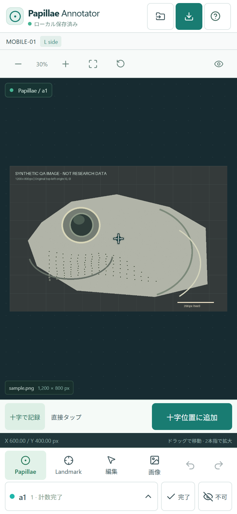
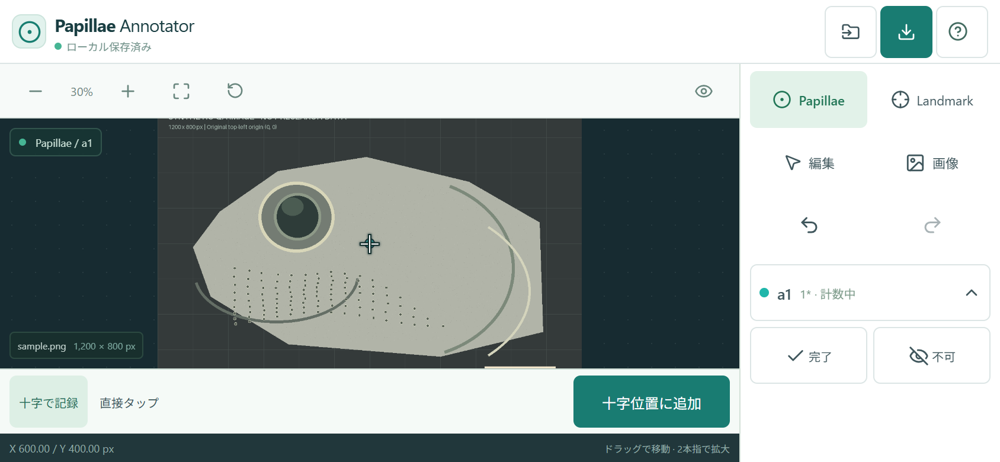
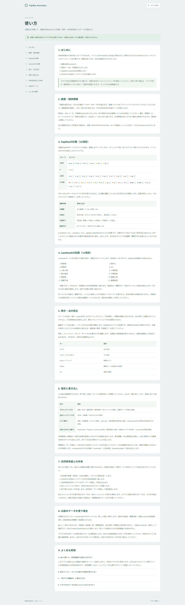
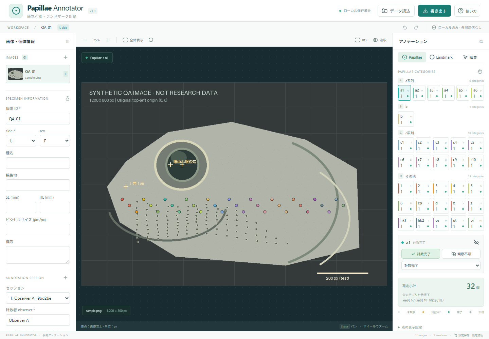

# 検証記録

## 2026-11-17 第一背鰭前端の追加

- 標準Landmarkの末尾に「第一背鰭前端」（`dorsal_origin`）を追加し、計13項目へ更新。PC・スマホ両方で選択・記録でき、全13項目の自動進行と完了、CSV/JSON/注釈PNGに反映されることを確認。
- 単体テスト37件、型検査・本番ビルド・整形検査が成功。追加テストは12点版の既存点・カテゴリ色・欠測・点IDの維持、未記録の新設、旧記録の復元、反復更新/再統合の重複防止、独自定義の維持、移行前バックアップの保全を検証する。
- 12点版の保存データをブラウザへ投入し、初回読込で13点版になること、新設点のクリック記録とCSVの元座標が一致すること、別セッションの保全済み第一背鰭前端が元の点ID・座標で戻ることを確認。移行前12点データを専用キーに保全し、再起動後もバックアップと全セッションが一致。
- 第一背鰭前端の保全記録はrecorded/unrecorded/unavailableのいずれも復元し、二重の点IDを作らない。旧9点版からの直接更新でも同じ項目の記録を維持し、保全用CSVには残る3項目を出力する。
- Edgeのブラウザテスト全22件成功。既存21件に移行・出力シナリオ1件を追加し、スマホのLandmarkシナリオにも第一背鰭前端の選択と中央十字からの記録を追加した。ダウンロード検証は11月16日と同じBlob取得モードを使用し、OS側の保存完了と実機スマホは引き続き検証対象外。

公開URLへの反映にはCommit/PushとPagesの公開処理が必要。この作業ではpush・デプロイは実行していない。

## 2026-11-16 スマホ対応

- `pnpm test`: 34件成功（既存28件＋タッチ座標・パン・ピンチ・キャンセルの6件）。TypeScript型検査・本番ビルド成功。
- Windows Edge 157.0.4341.60 / Playwrightの全21シナリオ成功（既存PC14件＋スマホ7件）。スマホは390×844・844×390・320×568、タッチ対応・DPR 2のエミュレーション。ページ内の未処理例外なし。
- 画像ファイルの読み込み、個体ID/計数者/sex、中央十字からの記録、直接タップ、元画像ピクセル座標、2本指拡大、1本指パン、キャンセル時の非記録、次のタップが1点だけ増えることを確認。
- 全32カテゴリをタッチ選択・各1点追加・完了指定し、CSVのa_total=6、c_total=10、papillae_total=32と一致。Landmarkの自動送り・観察不可・スキップ・自動OFF・記録済み再入力の拒否を確認。
- 編集でのタップ選択、中央への移動、元画像1px調整、削除、Undo/RedoをJSONと照合。縦横回転後も記録が一致し、横はみ出しがなく、小さい縦画面でも記録ボタンが画面内にあることを確認。スクリーンショットも目視確認。
- CSV、2種注釈PNG、JSONの生成、PNG元寸法、再読込による復元、PCへJSONを渡して内容が完全一致することを確認。既存PCテストでは全カテゴリ色のPNGピクセル・ZIP原本・欠測・旧データ移行・競合統合なども再検証。
- 自動保存の待機タイマーを停止し、点追加直後にpagehideを発生させてもIndexedDBに最新点が保存されることを確認。強制終了時の保存完了を保証するものではない。

この環境ではブラウザ標準ダウンロードが、最小の5バイトJSONでも全バイト受信後に完了しなくなる問題がEdge・Chrome・隔離したChromiumで再現した。テスト時のみ `PAPILLAE_CAPTURE_DOWNLOADS=1` を指定し、実アプリが生成したBlobとファイル名を保存への受け渡し直前に取得して検証した。内容検査や既存の期待値は省略していない。通常実行では従来どおりネイティブダウンロードをテストする。アプリ本体に検証用フックは含めず、ブラウザの保護設定も変更していない。今回の21件成功はこの取得方式によるもので、OSへの保存完了は検証対象外。

```powershell
$env:PAPILLAE_CAPTURE_DOWNLOADS='1'
pnpm run test:e2e
```

タッチ操作のCDP入力は各移動を20ms間隔にして実際の指の動きに近づけた。間隔なしで一瞬のフリックを送ると、Chromiumが直後のボタンへのクリックを抑止するため。iPhone／Androidの実機、Safari、OS固有のファイル選択・ダウンロード画面、実研究画像・大規模プロジェクトは未検証。公開先へのpush・デプロイは行っていない。





検証日: 2026-11-14（日本時間）。提供された添付は開発指示書のみで、DiASP実画像は含まれていませんでした。PNG/JPG/TIFFの合成画像を使って検証し、実研究データには触れていません。

## 2026-11-15 観察項目更新

- Papillaeは指定順の32項目。番号1〜6を独立した文字列IDとして扱い、a1〜a6、b、c1〜c10、その他の4グループを維持（番号1〜6は「その他」）。各グループのカテゴリ数は6／1／10／15。
- Landmarkは眼後端、眼中心、眼前端、AN、上唇上端、上顎前端、開口後端、下顎前端、顎後端、胸鰭上端、胸鰭下端、腹鰭前端の12点。画面・注釈画像の表示名とCSVのlandmark_labelを更新。
- 表紙の「観察を、確かな記録に。」を削除。独立したhelp.htmlと右上の「使い方」リンクを追加。
- TypeScript型検査・本番ビルド成功。`pnpm test`の28件、Windows Edgeの本番ビルド操作テスト14件がすべて成功。コード整形検査とgit diffの空白検査も成功。
- 全32カテゴリへの実クリックと確定値、a_total=6／c_total=10／papillae_total=32、全12Landmarkの自動進行、32カテゴリ色のPNGピクセル一致、CSV/JSON/ZIP出力を確認。
- 旧22カテゴリ・9LandmarkのJSONとブラウザ内データを移行し、孔器点・共通Landmarkの点ID/座標・旧観察状態を維持。新項目は未観察／未記録。外れた4Landmarkの元の名前・座標・状態をretired_landmarksに保全し、JSONと追加CSVから取り出せることを確認。
- ブラウザ内移行前のprojectコピーが元のまま残り、再読込で移行や同じ旧JSONの追加統合が重複しないことを確認。独自のカテゴリ定義は変更しない。
- GitHub Pagesに相当するサブディレクトリ `/papillae_annotator/` をローカルHTTPサーバーで再現し、アプリ・サンプル画像・help.html・相対アセット・目次リンクを検証。説明ページを開いたままアプリを再読込しても編集ロックが競合しない。
- 説明ページは1440pxと390px幅で描画。モバイル幅の横はみ出しがないことを確認し、実際の画像も目視確認。公開先のGitHubへのpush・デプロイはこの修正作業では実行していない。



## 初期版の環境と結果（2026-11-14）

- Windows / Node.js v24.22.1 / pnpm 11.25.0。
- React 19.3.1、Konva 10.9.1、Dexie 4.4.7、Vite 7.3.8（正確な依存関係はpnpm-lock.yaml）。
- `pnpm test`: **23件すべて成功**（ドメイン21件、IndexedDB 2件）。
- `pnpm run test:e2e`: TypeScript型検査・本番ビルド成功、Windows **Microsoft Edge 157.0.4341.46の11件すべて成功**。ブラウザテストはVite previewでdistを読み込んで実行。
- 同一ビルドに対してWindows **Google Chrome 157.0.8103.78でも11件すべて成功**。環境変数 `PLAYWRIGHT_EXECUTABLE_PATH` でChrome実行ファイルを選択し、`node node_modules/@playwright/test/cli.js test` で実行。
- `pnpm run format:check`: 成功。
- ビルド時のZod依存内のPURE注釈についてRollupが警告し、そのコメントを除去します。ビルド・実行・テストは成功し、生成物のJavaScriptチャンクはすべて500 kB未満です。

## 指定された18項目との対応

追加の表示・操作改善でも型検査・本番ビルド・単体23件・Edgeの操作11件が成功。画像パネルの拡大、Papillae用の小型カーソル、マウス移動時の座標表示・領域外でのリセットを確認しました。1440×1000の画面では画像ビューアが878×757pxから932×810pxに拡大し、フィット表示の画像幅も814pxから900pxへ拡大しています。2000点以上の記録を含む操作テストでも追加・選択・削除に成功。Chromeの全11件の結果は初期版の検証結果です。

注釈画像の2種類出力への変更後も、本番ビルド・単体23件・Edgeの操作11件が成功。2種ZIP内のPNG2枚が元サイズ1200×800であること、全22カテゴリの点の実ピクセル色がカテゴリ設定に一致すること（不透明度100%で検証）、Landmarkを含む版の全記録済みLandmarkが共通の黄色であること、含まない版では同位置が元画像のままであることを確認しました。各PNGの個別保存はZIP内の対応PNGとバイト一致。画面上で注釈を非表示にしても全記録を出力し、生成した2枚を実際に開いて目視確認しました。

| 指示書の検証項目                  | 検証内容                                                                                               |
| --------------------------------- | ------------------------------------------------------------------------------------------------------ |
| 1. ズーム・パン後の座標           | 座標変換の単体テストと、実キャンバスで拡大・Spaceパン後に点を追加してJSONの元座標を照合                |
| 2. 画像調整と座標の独立性         | 明度・ガンマ・チャンネルを変更し、保存済み全点が変化しないことを確認。リセットも操作                   |
| 3. 全22カテゴリ                   | 各カテゴリをクリックして1点ずつ追加、UIとCSVで全22個を確認                                             |
| 4. 4グループ                      | 定義の所属数5/1/9/7、合計a=5/c=9/全体22。1366×768で全カテゴリが画面内に表示                            |
| 5. 追加・削除・移動・カテゴリ変更 | 実マウスドラッグ、XY編集、カテゴリ変更、選択点削除。近接・同位置の連続クリックも1回ずつ計数            |
| 6. Undo/Redo                      | キーボードCtrl+Z/Ctrl+Yで削除を復元・再適用し、JSON点数を照合                                          |
| 7. Landmark一意性                 | 再クリックで編集へ誘導。移動で点IDを維持、記録済みの項目数が増えないことを確認                         |
| 8. 自動切り替え                   | 全9項目を順番にクリックし、選択移動と全記録完了表示を確認                                              |
| 9. 自動スキップ                   | 記録済み、観察不可、スキップを飛ばす。共通順序を単体/ブラウザ両方で確認                                |
| 10. 自動OFF                       | OFF後はクリックしても同じ選択を維持。修正時に自動進行しないことも確認                                  |
| 11. 両種の欠測                    | 部分的な記録で保存・出力・復元。未記録Landmarkも全9行、NA座標で出力                                    |
| 12. NAと0                         | 未観察/不可はNA、完了0は0、計数中は暫定。全対象が完了するまで完全合計はNA                              |
| 13. sex                           | M/F/空欄を保存・再出力。空欄はCSVでNA                                                                  |
| 14. L/R分離                       | 同じ個体IDに異なる画像IDのL/Rを登録し、それぞれの点・座標・sideを確認                                  |
| 15. 観察者の分離                  | 同一画像にAlice/Bobの別セッションを作成し、元セッションを保持。競合JSONも別セッション化                |
| 16. CSV整合                       | 計数22と座標22行を照合、状態22行とLandmark9行を検証。CSV復元と不整合時の拒否も確認                     |
| 17. JSON完全復元                  | 別ブラウザコンテキストへ画像埋込みJSONを読み込み、全セッションを照合。ハッシュ・寸法の不正入力を拒否   |
| 18. 自動保存・再起動              | ページ再読込、IndexedDB接続の閉鎖/再接続、ブラウザプロセス完全終了後の同一プロファイル再起動で完全一致 |

追加で、TIFF/JPGのデコード、ROI内クリックの元座標、ROI後の別サイズ画像への切替、複数タブの書込ロック、カテゴリ設定の共有、PNG寸法1200×800、ZIP内原画像の元ファイルとのバイト一致、JSON/CSVの追加統合、無効JSONの原子的拒否、2000点以上のセッションへのクリック追加と削除を確認しました。



## 再現方法と限界

```sh
pnpm install --frozen-lockfile
pnpm test
pnpm run test:e2e
pnpm run format:check
```

HTMLレポートは `playwright-report/index.html`。失敗時は `test-results/` にスクリーンショット・トレースを残します。検証用画像の生成にはPython/Pillowで `python scripts/make_sample.py` を実行します。通常のアプリ起動・ビルド・テストではPythonは不要です。

今回の検証は合成画像によるUI/データ整合性の確認です。DiASP実画像の視認性、巨大画像、全TIFF圧縮方式、BigTIFF、タッチ入力、Firefox/Safari、ブラウザの容量枯渇時の実測は対象外です。保存容量・メモリの制限があるため、大きなデータセットは分割し、JSON/ZIPバックアップを保管してください。GitHub Pagesの公開ワークフローは用意しましたが、実際のリポジトリ作成・外部公開は実行していません。

開発指示書の保全コピーは `DEVELOPMENT_SPEC.md`。添付原本とのSHA-256一致を確認済み: `9d433b1d7b4b2894361c8f2f21a0638711da1c832f164480d19906a140b0afa4`。
